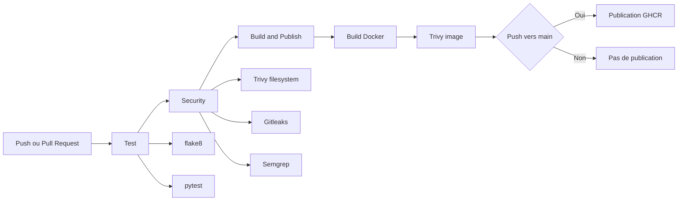

# DevSecOps Pipeline Demo

[](https://github.com/VOTRE-USERNAME/devsecops-pipeline-demo/actions/workflows/ci.yml)

Mini-projet DevSecOps autour d'une petite API Flask. À chaque push ou pull request, GitHub Actions lance le linting, les tests, les scans de sécurité, construit une image Docker, scanne cette image, puis publie l'image conteneur sur GitHub Container Registry uniquement lors d'un push vers `main`.

Le projet publie une image conteneur. Il ne réalise pas de déploiement automatique en production.

## API

Routes disponibles :

| Route | Description |
| --- | --- |
| `/health` | Vérifie que l'API répond correctement |
| `/add/<a>/<b>` | Retourne la somme de deux entiers |

## Pipeline



## Utilisation Locale

Créer un environnement virtuel et installer les dépendances de développement :

```powershell
python -m venv .venv
.\.venv\Scripts\Activate.ps1
pip install -r requirements-dev.txt
```

Lancer les vérifications :

```powershell
flake8 app
pytest app
```

Installer uniquement les dépendances de production :

```powershell
pip install -r requirements.txt
```

Lancer l'API en local :

```powershell
python app\main.py
```

Tester l'API :

```powershell
curl http://localhost:5000/health
curl http://localhost:5000/add/2/3
```

Construire et lancer l'image Docker :

```powershell
docker build -t devsecops-pipeline-demo:local .
docker run --rm -p 5000:5000 devsecops-pipeline-demo:local
```

## Choix De Sécurité

L'image Docker utilise `python:3.12-slim` pour limiter la surface d'attaque. Elle installe uniquement les dépendances de production depuis `requirements.txt`, sans les outils de test et de linting.

L'application tourne avec un utilisateur système non-root. Si l'application est compromise, l'impact est réduit car le processus n'a pas les privilèges root dans le conteneur.

Le pipeline applique le principe du moindre privilège. Les permissions globales GitHub Actions sont limitées à `contents: read`, et `packages: write` est accordé uniquement au job chargé de publier l'image.

Trivy scanne les fichiers du dépôt et l'image Docker. Le pipeline échoue si Trivy détecte une vulnérabilité `HIGH` ou `CRITICAL` selon la configuration du workflow.

Gitleaks détecte les secrets accidentellement ajoutés au dépôt, comme des tokens ou mots de passe, et fait échouer le job lorsqu'un secret est détecté.

Semgrep réalise une analyse statique orientée sécurité sur le code Python. Le workflow utilise `--error`, donc une règle Semgrep déclenchée fait échouer le job.

Dependabot surveille les dépendances Python, Docker et GitHub Actions afin de proposer des mises à jour régulières.

La publication GHCR est volontairement limitée aux pushs sur `main`. Les pull requests construisent et scannent l'image, mais ne publient rien.

## Bonus Kubernetes

Le workflow `deploy-kind.yml` peut être lancé manuellement depuis l'onglet Actions. Il crée un cluster Kubernetes avec kind sur un runner GitHub, charge l'image Docker locale, applique les manifests du dossier `k8s/`, attend le Deployment, puis teste le Service avec `curl --fail` afin qu'une erreur HTTP fasse échouer le workflow.

Ce workflow est une démonstration locale sur runner GitHub, pas un déploiement de production.

## Ce Que J'ai Appris

Ce projet m'a permis de mettre en place une chaîne DevSecOps simple mais réaliste : séparation CI/CD, quality gate par tests et scans, publication conditionnelle d'image, permissions minimales dans GitHub Actions, durcissement Docker et automatisation de la maintenance avec Dependabot.

Il montre aussi que la sécurité doit être intégrée à chaque étape : code, dépendances, secrets, image conteneur et manifeste Kubernetes.
